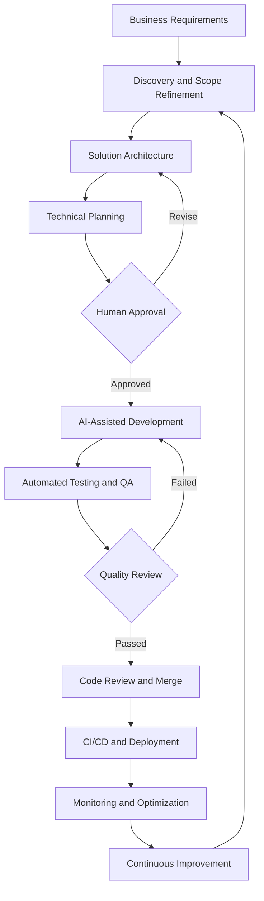

<h1 align="center">Danyal Rashid</h1>

<h3 align="center">
Engineering Leadership | Solution Architecture | Generative AI | Cloud & DevOps
</h3>

  
  
  

---

## About Me

I architect, build, and lead the delivery of production-grade software systems.

My work sits at the intersection of software engineering, artificial intelligence, cloud infrastructure, and engineering automation. I combine hands-on technical expertise with engineering leadership to transform complex business requirements into scalable, secure, and maintainable technology solutions.

I believe in building systems that are not only functional, but also reliable, observable, cost-efficient, and operationally sustainable.

---

## What I Do

### Engineering Leadership & Solution Architecture

- Lead cross-functional engineering teams and technical delivery.
- Translate complex business requirements into scalable technical architectures.
- Design enterprise applications and cloud-native SaaS platforms.
- Establish engineering standards, architectural patterns, and development workflows.
- Drive technical decisions across security, scalability, performance, and cost.
- Mentor engineers and enable teams to deliver independently.

### Generative AI & Agentic Engineering

- Architect and build production-grade Generative AI applications.
- Delivered two Generative AI products using Amazon Bedrock and the AWS ecosystem.
- Design enterprise Retrieval-Augmented Generation (RAG) pipelines.
- Build intelligent document processing and knowledge retrieval systems.
- Develop MCP servers, tool-enabled AI agents, and agentic workflows.
- Take AI solutions beyond proof of concept into production.
- Lead teams responsible for operating and evolving AI-powered products.

### Cloud Engineering & DevOps

- Design and manage cloud-native application infrastructure.
- Build containerized applications and deployment architectures.
- Implement automated CI/CD pipelines and environment management.
- Manage production infrastructure, application reliability, and operational security.
- Optimize infrastructure performance and cloud expenditure.
- Reduce operational overhead through automation.

### AI-Driven Software Delivery

- Design AI-native software development workflows.
- Automate requirements refinement, technical planning, and task decomposition.
- Integrate coding agents and execution harnesses into engineering processes.
- Connect product planning, development, automated QA, and deployment.
- Establish automated testing and validation mechanisms.
- Enable autonomous engineering workflows with human-in-the-loop governance.

---

## How I Work

I follow an architecture-first, automation-driven approach to software delivery, combining AI-native engineering with human accountability.

### Engineering Principles

| Principle | Philosophy |
| :--- | :--- |
| Business First | Technology exists to solve meaningful business problems. |
| Architecture First | Make deliberate technical decisions before implementation. |
| Automation by Default | Automate repetitive and predictable engineering tasks. |
| AI-Native Engineering | Integrate AI throughout the development lifecycle. |
| Security by Design | Embed security into architectural and engineering decisions. |
| Production Mindset | Build for reliability, maintainability, and scale. |
| Human Accountability | AI accelerates execution; humans own critical decisions. |
| Simplicity over Complexity | Choose the right solution, not the most complicated one. |

---
## Technology Stack

### Generative AI & Agentic Engineering

### Programming Languages

### Backend & Frontend Engineering

  

### Databases & Data Engineering

  

### Cloud, Infrastructure & DevOps

  

### Developer Tools & Delivery

  

---

## Current Areas of Focus

- Autonomous and multi-agent engineering systems.
- AI coding agents and execution harnesses.
- End-to-end software delivery automation.
- MCP ecosystems and agent interoperability.
- Enterprise AI orchestration and evaluation.
- Human-in-the-loop governance for autonomous systems.
- Cost-efficient and scalable AI infrastructure.
- Developer productivity and engineering intelligence.
---

## GitHub Activity

  

  
  

Much of my professional work takes place in private enterprise repositories and proprietary production environments. My public repositories represent only a portion of my engineering experience.

---

## Open to Collaboration

I'm interested in meaningful projects, remote engagements, and technical consulting opportunities involving:

- Enterprise Generative AI and LLM applications
- RAG and intelligent document processing
- Agentic AI and MCP integrations
- Solution architecture and technical consultancy
- Cloud infrastructure and DevOps automation
- SaaS product engineering
- AI-driven engineering transformation
- Open-source tools and developer productivity

---

## Connect With Me

  
  
  
  
  

---

  <b>Architect with intent. Engineer for scale. Automate with purpose.</b>

